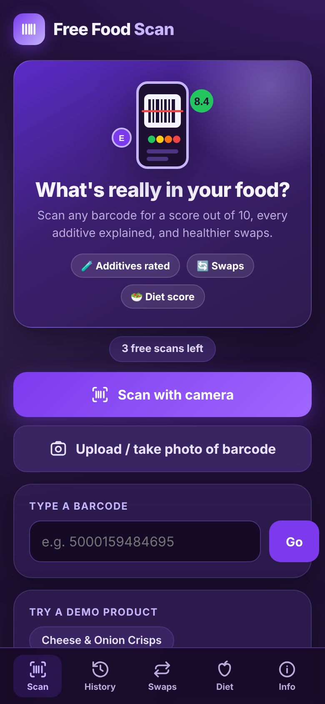

# SafeScan – what's really in your food? 🔍

**Scan any barcode and get a score out of 10, every additive explained, healthier swaps and a personal diet score.**

👉 **Try it free: [akaskaok646.github.io/SafeScan](https://akaskaok646.github.io/SafeScan/)**
No sign-up, no ads, works on any phone – and you can install it on your home screen like a normal app.

## What it does

- 📷 **Scan with your camera** – or upload a photo of a barcode, or type the number
- 🟢🟡🟠🔴 **Score out of 10** – based on nutrition, additives and how processed the food is
- 🧪 **Every additive explained** – tap one to see what it is, how much is safe for your body weight, and the suspected risks (from EFSA, IARC and UK FSA positions)
- ⚖️ **Amounts matter** – checks whether a serving could get close to your safe daily limit
- 🔄 **Healthier swaps** – finds higher-scoring products in the same category
- 🥗 **Diet score** – add what you eat, how much and how often, and see how it compares with what someone like you needs (NHS / SACN guidance)
- 📴 **Works offline** – history and diet are saved on your phone

## How the score works

| Part | Points | Based on |
|---|---|---|
| Nutrition | up to 6 | Nutri-Score grade |
| Additives | up to 3 | Each additive's risk level |
| Processing | up to 1 | NOVA group |

Any high-risk additive (like titanium dioxide or nitrites) caps the score at 4.9. Full details are in the app's **Info** tab.

## Privacy

No accounts and no tracking. Your history, diet and details stay on your device. [Privacy policy](privacy.html)

## Data

Product data from [Open Food Facts](https://world.openfoodfacts.org) (ODbL), USDA FoodData Central and UPCitemdb.
Information only – not medical advice.

---

Made by a UK A-level student combining chemistry, biology and code. Feedback welcome – [open an issue](https://github.com/akaskaok646/SafeScan/issues).
